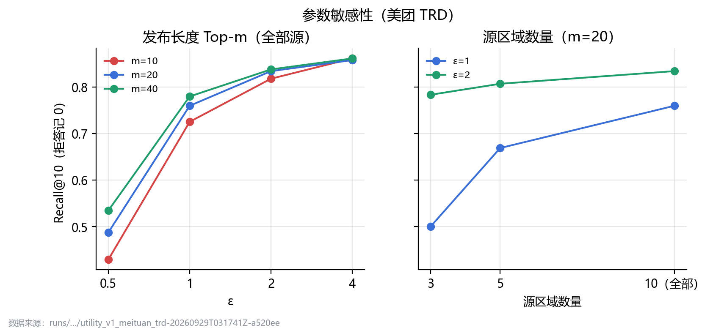

# PrivEdge：面向新区域开站选品的多源隐私保护可信 Top-K 需求情报系统

> 报告初稿（2026-09-29）。按往届获奖报告的章节结构组织，内容为本作品原创。正式版排入官方当届模板：宋体小四、1.5 倍行距、A4，匿名，PDF ≤ 10 MB。所有数字都可以在 `02_实验证据登记.md` 中按编号（E1–E19）找到运行目录。

---

## 摘要

配送企业在新区域开设前置仓或配送站（包括低空无人机配送站点）时，必须在没有任何历史订单的情况下决定首批备货的热门品类。已运营区域掌握大量订单，但个人消费行为可以推断住址、健康和经济状况，受《个人信息保护法》约束，不能直接共享。本地差分隐私（LDP）可以在用户设备上扰动数据后再汇聚，但它带来一个新的安全问题：LDP 数据对汇聚方不可验证，伪造用户的报告混在噪声中无法分辨，持有合法密钥的发布者也可能被攻破后发布任意摘要。

本作品提出 PrivEdge。各已运营区域只发布经 OLH 扰动、带 Ed25519 签名和哈希链预算记账的 Top-m 品类摘要；新区域的网关逐项验证后做抗投毒融合，输出 Top-10 品类和“正常 / 降级 / 拒答”三态结论。作品有三项创新：

1. 面向 LDP 摘要的两层抗投毒聚合：发布端利用 OLH 已知噪声结构检测伪造用户，网关端组合留一共识截尾、多源支持规则和权重封顶。
2. 支持规则与有界影响的可证明容错界。
3. 经 ProVerif 形式化验证的签名发布协议与可审计预算账本。

在美团外卖 TRD 真实订单（北京 11 个商圈）上，ε=2 时 PrivEdge 恢复的新商圈 Top-10 Recall 为 0.835，非隐私参照为 0.873。1 个区域混入 10% 伪造用户时，攻击成功率由 0.90 降到 0。被攻破发布者谎报方差劫持融合权重时，只做截尾的系统 NDCG 降到 0.24–0.32，PrivEdge 保持在 0.89–0.96。ProVerif 在 Dolev-Yao 攻击者下验证了认证、窗口绑定、账本绑定、不可代扣预算和角色隔离 5 条性质。全部实验按预注册执行，不利结果同样报告。

**关键词**：本地差分隐私；Top-K 频率估计；数据投毒；拜占庭鲁棒聚合；形式化验证；冷启动选品

---

## 第一章 作品概述

### 1.1 研究背景

**业务需求。** 即时零售与外卖配送依赖前置仓和配送站：站点覆盖约 3 公里的服务范围，库存容量有限，开站首月的备货决定了缺货率与损耗。新开站区域没有历史订单，常见做法是参照相邻或相似区域的销售。低空无人机配送进一步放大了这一需求：无人机站点载重和航线有限，首批只能覆盖少数品类，选错的代价更高。

**隐私约束。** 区域订单由各站点或加盟商掌握。订单中的品类可以推断个人的饮食、健康（药品）、宗教和经济状况，属于敏感个人信息。把原始订单汇聚到一处建模，需要逐一取得用户同意，而且汇聚方本身成为新的泄露点。

**LDP 带来的新攻击面。** LDP 让用户在设备上扰动数据，汇聚方只看到噪声报告，从源头消除了汇聚方泄露的风险，已被 Apple、Google 等用于大规模统计 [2][17]。但 LDP 的噪声使汇聚方无法核实任何一个用户，这正好给投毒留下空间：已有研究表明，少量伪造用户就能按最大增益策略（MGA）把任意冷门类别推进频率估计的 Top-k [5][6]。在多区域场景中还有第二类攻击者：持有合法签名密钥的区域发布者被攻破后，可以直接发布任意摘要。它不需要伪造用户，任何发布端检测都对它无效。

### 1.2 相关工作

**LDP 频率估计与 Top-k。** RAPPOR [2] 和 OLH [1] 是频率估计的代表协议。OLH 用随机哈希把大类别域压缩到 \(g=\lfloor e^\varepsilon\rfloor+1\) 个桶，在大域上方差最优。重要项识别方面有 Succinct Histogram [3] 和 PEM [4]。这些工作都假设单一汇聚方和诚实用户，不处理多源融合与投毒。

**LDP 投毒攻击与防御。** Cao 等 [5] 提出针对 kRR、OUE、OLH 的最大增益攻击，并讨论了基于频繁项集的检测；Cheu 等 [6] 从理论上给出了 LDP 协议对操纵攻击的脆弱性下界；Wu 等 [7] 把攻击扩展到键值数据；LDPRecover [8] 在汇聚端做频率恢复。它们都只处理单一汇聚方内的伪造用户，没有考虑合法发布者被攻破，也没有给出摘要级的完整性和可审计性。

**拜占庭鲁棒聚合。** 分布式学习中的截尾均值、中位数 [9] 和 Krum [10] 可以容忍少数恶意节点，但它们面向梯度向量，不利用 LDP 已知的噪声结构，也不处理“只发布 Top-m”造成的截断缺失。已有研究还表明，自适应攻击可以绕过这类聚合 [23]。

**隐私预算审计与协议验证。** 差分隐私的组合定理 [15] 要求对重复发布累计预算；Privacy Budget Scheduling [21] 把预算当作可调度资源。证书透明 [14] 用仅追加的 Merkle 日志让第三方审计证书签发。ProVerif [11] 可以在 Dolev-Yao 攻击者 [12] 下自动验证协议的认证与保密性质。

**技术空白。** 现有工作中，隐私（LDP）、鲁棒性（抗投毒 / 拜占庭聚合）和可验证性（签名、审计、形式化验证）三条线彼此独立。对“多个区域各自发布 LDP Top-m 摘要、新区域据此冷启动”这一场景，还没有同时满足以下三点的方案：(a) 能同时应对伪造用户和被攻破的合法发布者；(b) 对被攻破发布者给出不依赖统计假设的保证；(c) 摘要来源、窗口和预算消耗可以被第三方审计。

### 1.3 特色分析

| 特色 | 说明 | 证据 |
|---|---|---|
| 原始数据不出设备 | 用户端 OLH 扰动，区域只发布 Top-m 摘要（约 2.3 KB，与用户数无关） | E6 |
| 两类攻击者都能防 | 伪造用户由发布端检测；被攻破发布者由网关截尾、支持规则、权重封顶限制 | E9、E13 |
| 主动找自己的漏洞 | 自己构造了谎报方差的权重劫持攻击，发现只做截尾时 NDCG 最多下降 0.66，再设计并确认修复 | E12、E13 |
| 可证明 | 支持规则的注入免疫（界是紧的）；诚实多数下的有界影响 | E17 |
| 可验证、可审计 | ProVerif 5 条性质；4 个负对照；账本篡改可精确定位到条目 | E16、E18 |
| 证据纪律 | 预注册、不在同一批数据上调参重跑、确认性复验用新种子、失败判定照写 | 全部 |

### 1.4 应用前景

- **前置仓 / 配送站开站选品**：主场景，对应美团 TRD 的“新商圈”设定。
- **低空无人机配送站点**：同样的冷启动问题，品类更少、选错代价更高，Top-10 与三态结论可以直接用于首批航线的载货配置。
- **跨企业 / 跨加盟商的需求情报共享**：各方不交换订单，只交换签名的隐私摘要，账本可供监管方审计。
- **其他 LDP 统计**：签到、App 使用、输入法热词等频率统计，同样面临伪造用户和被攻破汇聚节点，协议可以直接复用。

---

## 第二章 作品设计与实现

### 2.1 问题模型

- **区域（源）** \(S_1,\dots,S_n\)：已运营区域。窗口内每个用户 \(u\) 贡献一个品类 \(x_u\in\mathcal D\)，\(|\mathcal D|=d\)。
- **用户端**：用 OLH 扰动 \(x_u\) 后上报，原始值不离开设备。
- **区域发布者**：对报告做频率估计，只发布估计值最高的 Top-m 品类、估计频率和方差，封装为签名的 `ReleaseEnvelope` 并在账本登记。
- **新开站区域（目标）\(T\)**：没有任何私有行为数据，只能读取各源的摘要。
- **输出**：Top-k 品类（k=10），每个品类的支持源数，以及三态结论与原因码。
- **离线评估器**：唯一能读取目标真值的模块，只在实验中计算 Recall@10 与 NDCG@10。代码层面用接口隔离，并有测试保证推理接口不能接收目标真值。

### 2.2 安全模型

| 角色 | 假设 | 能力 | 目标 |
|---|---|---|---|
| 区域汇聚方 | 诚实但好奇 | 看到本区全部 LDP 报告 | 推断单个用户的品类 |
| 伪造用户 | 主动 | 向某区域注入按 MGA 构造的 OLH 报告 | 把指定冷门品类推进目标 Top-10 |
| 被攻破发布者（f 个） | 主动，持有合法签名密钥 | 发布任意摘要：抬高目标品类、谎报极小方差、发布负频率、同一窗口提交多份不同摘要 | 注入品类或破坏排序 |
| 网络攻击者 / 第三方 | Dolev-Yao | 窃听、篡改、重放旧窗口摘要、用未注册密钥冒充、以他人名义向账本登记 | 让目标使用伪造或过期信息；耗尽他人预算 |
| 目标网关 | 诚实但好奇 | 看到全部摘要 | 反推源区个体 |

不在范围内：用户是否参与本身的隐私；最终 Top-10 与外部知识结合的群体推断；诚实少数（被攻破源过半）。

### 2.3 设计目标

1. **隐私**：每个用户每个窗口满足 ε-LDP；同一窗口多次发布按顺序组合累加，超过上限拒绝。
2. **完整性与真实性**：摘要的任何篡改、重放、冒充、跨窗口挪用都能被检测；账本条目不能被伪造或静默修改。
3. **鲁棒性**：少于 t 个被攻破发布者无法注入诚实源都没发布的品类；诚实多数下任何一个源的影响有界；伪造用户比例 ≥5% 时攻击成功率 ≤ 0.02。
4. **效用**：ε≥2 时 Top-10 接近非隐私参照；开启全部防御后无攻击时 NDCG 损失 ≤ 0.02。
5. **可用性**：证据不足时降级或拒答，给出原因码；每次输出都有可复核的审计记录。
6. **效率**：摘要大小与用户数无关；网关一次预测在 10 ms 量级。

### 2.4 系统总体框架


*图 2-1 PrivEdge 控制台总览页：五步流程与核心指标（指标读取自已登记运行目录）*


*图 2-2 PrivEdge 系统总体框架*

数据流分五步：

1. 用户端 OLH 扰动；
2. 区域发布者聚合并做伪造用户过滤，发布签名的 Top-m 摘要；
3. 账本验签后登记，按窗口累计预算；
4. 目标网关逐项验证后做鲁棒融合；
5. 三态决策并写入审计记录。

后端通过 REST 与 WebSocket 把每一步推送给控制台。

模块划分：

| 模块 | 职责 |
|---|---|
| `ldp` | OLH 扰动、频率估计与方差 |
| `pipeline` | 发布端聚合 + 伪造用户联合支持过滤 |
| `envelope`、`keys` | 规范化序列化、Ed25519 签名（覆盖窗口号）；(主体, 角色) 密钥注册表 |
| `ledger` | 仅追加哈希链；登记前验签；按窗口顺序组合记账 |
| `gateway` | 签名与角色、窗口、域哈希、账本核对、同源多摘要、格式检查 |
| `robust`、`decision` | 留一共识截尾（下限 0）、支持规则、权重封顶、方差加权融合、三态决策 |
| `attacks` | 10 类攻击的实现（实验与演示共用） |
| `server`、`web` | FastAPI + WebSocket 后端；React 控制台 |
| `experiments` | 预注册实验运行器；每次运行写入独立目录，含代码指纹、环境与数据哈希 |

### 2.5 方案设计思路及原理

#### 2.5.1 LDP 发布

OLH 下，用户随机选择哈希种子 \(h\)，把品类映射到 \(g\) 个桶，再以概率 \(p=\frac{e^\varepsilon}{e^\varepsilon+g-1}\) 保留真实桶。源端的无偏估计为

\[
\hat f_i=\frac{\frac1N\sum_u \mathbb 1[h_u(i)=y_u]-\frac1g}{p-\frac1g},\qquad
\mathrm{Var}[\hat f_i]\approx\frac{4e^\varepsilon}{N(e^\varepsilon-1)^2}.
\]

发布端只输出 Top-m 的 \((i,\hat f_i,\mathrm{Var}_i)\)。截断和融合都是对 LDP 输出的后处理，不增加隐私损失 [15]。实现与团队原始研究代码逐位一致（E1），原始代码以逐字节副本形式保存在包内，并有哈希校验。

#### 2.5.2 发布端：伪造用户的联合支持检测

MGA 伪造用户要同时推高多个目标品类，所以每份伪造报告都要“支持”全部目标。OLH 的噪声结构是已知的：对任意一对品类，诚实报告同时支持两者的概率可以精确算出。发布端在候选集（2m 个品类）上计算每对品类的联合支持超额量（z 分数阈值 6），贪心扩展成可疑项集（保留比例 0.7），剔除支持项集全部成员的报告。无攻击时这个检测从不触发（E9）。

```text
算法 1  发布端伪造用户过滤 FilterFake(R, ε)
输入：OLH 报告集合 R（每份报告 = 哈希种子 + 桶），隐私预算 ε
参数：候选数 C = 2m，z 阈值 τ = 6，最大项集 8，保留比例 ρ = 0.7
 1: f̂ ← Aggregate(R)；  P ← f̂ 最高的 C 个品类
 2: 对每份报告 r、每个 c ∈ P：sup[r, c] ← [H_r(c) = y_r]          ▷ 报告 r 是否"支持" c
 3: 对每对 (a, b) ⊂ P：z_ab ← (Σ_r sup[r,a]·sup[r,b] − E_ab) / √E_ab   ▷ E_ab 由 OLH 的 p、q 精确给出
 4: 若 max z_ab ≤ τ：返回 R                                          ▷ 无攻击时在此返回
 5: S ← argmax 的品类对；  M ← {r : r 支持 S 的全部成员}
 6: 重复直到 |S| = 8 或无法扩展：
 7:     选 c ∉ S，使 M ∩ sup[·, c] 的超额量 ≥ ρ·当前超额量 且 z > τ，超额量最大
 8:     S ← S ∪ {c}；  M ← M ∩ {r : sup[r, c]}
 9: 返回 R \ M
```

#### 2.5.3 网关端：截尾、支持规则、权重封顶

设网关接受了 n 份来自不同源的摘要。

- **留一共识截尾**：对源 s 的品类 i，用其余源的中位数作共识，用其余源的 MAD 与方差中位数构成尺度，把 \(x_{s,i}\) 截到 \([0,\ \text{共识}+c\cdot\text{尺度}]\)（c=3）。尺度不使用被检源自报的方差，所以谎报方差无法放宽自己的截尾区间。下限 0 保证发布负频率不能压低真实热门。
- **支持规则**：品类至少被 t=2 个源发布才能进入候选集。
- **权重封顶**：方差加权融合中，每个源的权重不超过其余源权重中位数的 κ=2 倍。
- **融合与决策**：在候选集中按封顶后的方差加权分数取 Top-10。满足支持规则的候选不足 10 个，或接受的源少于 3 个时，结论为拒答。源间 Top-m 平均 Jaccard 低于 0.2 时，结论为降级。

```text
算法 2  网关鲁棒融合 RobustTopK({(M_s, x_s, σ²_s)}_{s=1..n}, k)
参数：支持阈值 t = 2，截尾系数 c = 3，相对下限 ρ = 0.25，封顶 κ = 2，下限 0
 1: sup(i) ← |{s : i ∈ M_s}|；  A ← {i : sup(i) ≥ t}                  ▷ 支持规则（定理 1）
 2: 对每个源 s、每个 i ∈ M_s：                                        ▷ 留一共识截尾
 3:     med ← median_{s'≠s} v_{s',i}；  mad ← 1.4826·median_{s'≠s} |v_{s',i} − med|
 4:     noise ← median_{s'≠s} σ²_{s',i}                               ▷ 不用 s 自报的方差
 5:     x̃_{s,i} ← max(0, min(x_{s,i}, med + c·√(noise + mad² + (ρ·med)²)))
 6: w_s ← 1 / 平均不确定度(s)；  w_s ← min(w_s, κ·median_{s'≠s} w_{s'})  ▷ 权重封顶（定理 2）
 7: score(i) ← Σ_s w_s·x̃_{s,i} / Σ_s w_s                              ▷ 未发布的品类按 0 计
 8: 返回 A 中 score 最高的 k 个品类（不足 k 个时决策为拒答）
```

v_{s',i} 为稠密值：源 s' 发布了 i 就取其频率，否则取该源最小发布频率的一半。

权重封顶来自我们自己构造的攻击：SECURITY_V3 发现，被攻破发布者把方差缩小 10⁴ 倍，就能在方差加权中独占权重。只做截尾时，“劫持 + 扣下真实热门”使 NDCG 下降 0.44–0.66（E12）。

#### 2.5.4 签名发布协议与账本

- `ReleaseEnvelope` 的规范化 JSON（键排序、UTF-8、无空白）经 Ed25519 签名。签名覆盖源、窗口号、域哈希、机制参数、ε、用户数和全部条目。
- 密钥注册表把每把公钥绑定到 (主体, 角色)，数据源密钥不能签上下文，反之亦然。
- 账本是仅追加的哈希链：每条记录包含前一条哈希，登记前按注册表验签。同一源同一窗口的 ε 按顺序组合累加，超过上限拒绝登记。
- 网关除验签外，还核对摘要与账本中该编号登记的摘要值一致。同一源在一次请求中提交多份摘要时，全部拒收（EQUIVOCATION）。

这些检查都来自设计审查中发现并修复的缺陷，每个都有单元测试，见 2.6 节。


*图 2-3 签名摘要发布与准入协议（每个窗口）*

#### 2.5.5 三态输出

| 状态 | 条件 | 行为 |
|---|---|---|
| 检查通过 | 其余情况 | 输出 Top-10、支持源数、来源与账本摘要值 |
| 降级 | 源间一致性低（LOW_AGREEMENT）等 | 仍输出，标注原因码 |
| 拒答 | 接受的源 < 3，或满足支持规则的候选 < 10，或账本哈希链断裂 | 不输出，给出原因码 |

三态只表示输入检查和来源一致性是否达标，不表示预测质量。TRD 在 ε=0.5、m=40 时，效用实验的运行可以全部为检查通过，而平均 Recall@10 仍明显低于非隐私参照（E10）。单份摘要验签失败、重放、域错配、预算超限，只拒收该份，不直接拒答整个请求。

### 2.6 安全性分析

#### 2.6.1 隐私

- 用户端 OLH 满足 ε-LDP [1]；发布端的截断、过滤与网关的融合都是后处理，不增加隐私损失 [15]。
- 同一窗口的多次发布按顺序组合累加 ε，账本在登记时强制上限（默认单窗口 ε ≤ 4），并拒绝非正、非有限的 ε。
- “不同窗口按并行组合、隐私损失不累加”依赖一条部署假设：每个用户在每个窗口最多贡献一次，且不同窗口的用户集合不相交。账本只按“源 + 窗口编号”记账，不会自行验证换一个窗口号之后是不是同一批人。报告和演示都按这条假设表述，不把它写成已验证的事实。
- 账本登记前验签（修复前的缺陷见下），第三方无法以他人名义扣预算，从而无法用预算耗尽造成拒绝服务。

#### 2.6.2 容错定理

**定理 1（支持规则）**：对任意 f 个被攻破源发布的任意内容，输出中的每个品类都至少被 t−f 个诚实源发布过。
- 证明：输出只来自支持数 ≥ t 的候选集，其中至多 f 个支持者被攻破。
- 推论（注入免疫）：f < t 时，没有任何诚实源发布过的品类不可能进入输出。
- 这个界是紧的：f=t=2 时构造的注入 300/300 次成功。
- 400 组 × 2 种配置的随机对抗性质测试全部满足定理（任意类别集合、频率 ±10⁶、方差 10⁻¹²–10²）。

**定理 2（有界影响）**：设 f < (n+1)/2（诚实多数），κ ≥ 1，截尾下限为 0。记 \(S_i^H\) 为诚实源截尾后的值按封顶权重做的加权平均，则任意品类 i 的融合分数满足

\[
(1-\alpha)S_i^H\le S_i\le(1-\alpha)S_i^H+\alpha U_i,\qquad
\alpha\le\frac{f\kappa W}{(n-f)w+f\kappa W},
\]

其中：
- \(U_i\) 由诚实源的最大值、极差和方差给出；
- W、w 为诚实源权重的最大、最小值。

证明依赖四个引理：
- 引理 A：诚实多数下，留一中位数落在诚实值区间内；
- 引理 B：截尾上界；
- 引理 C：截尾下界为 0；
- 引理 D：被攻破源的权重份额上界。

完整证明见附录 A（`03_容错定理与证明.md`）。

例：诚实源权重相近（W≈w）、n=10、f=1、κ=2 时 α ≤ 2/11 ≈ 0.18。没有封顶时，谎报方差可使 α 接近 1。这里的 \(S_i^H\) 是攻击输入下、诚实源经过留一截尾之后的分量，不是“无攻击时的融合分数”；攻击者仍可能通过留一统计量轻微影响诚实源的截尾上限。

**定理推导发现的实现缺陷（均已修复并加测试）**：
- 若允许同一源提交多份摘要，f 的计数会被突破，于是增加 EQUIVOCATION 拒收；
- 若截尾没有下限，被攻破源可以发布 −10⁶ 压低任意品类，于是加下限 0。

全部网格上 67,200 个诚实发布值中负值为 0 个（E15），所以下限不改变任何已记录结果。

#### 2.6.3 ProVerif 形式化验证

模型 `formal/privedge_release.pv` 包含：
- 诚实数据源 A、B、T 与 T 的上下文机构；
- Dolev-Yao 网络攻击者；
- 数据源 T 的签名密钥被泄露；
- 只登记验签通过条目的账本；
- 检查注册表角色、签名、窗口和账本值的网关。

结果（E16，全部验证约 2 秒）：

| 编号 | 性质 | 结果 |
|---|---|---|
| Q1 | 认证、完整性、窗口绑定：网关接受的 (源, 窗口, 编号, 摘要) 一定由该源为该窗口发布，除非该源密钥泄露 | 成立 |
| Q2 | 账本绑定：网关接受的摘要一定与账本中该编号的登记值一致，对被攻破源同样成立 | 成立 |
| Q5 | 不可代扣预算：账本中记在某源名下的条目一定由该源本人发布，除非其密钥泄露 | 成立 |
| Q3 | 上下文角色隔离：T 的数据源密钥泄露后，仍无法伪造 T 区域的上下文 | 成立 |
| Q4 | 原始数据对网络攻击者保密（摘要建模为单向函数，不是差分隐私证明） | 成立 |
| S1、S2 | 可达性检查：接受事件确实可以发生，模型不是空转 | 可达 |

负对照：每个只去掉代码中的一项检查，验证模型确实能发现问题。

| 负对照 | 去掉的检查 | 被破坏的性质 |
|---|---|---|
| nc1 | 窗口号不在签名内 | Q1、Q2（旧窗口摘要可改标后重放） |
| nc2 | 注册表不区分角色 | Q3 |
| nc3 | 网关不核对账本 | Q2（给网关一份、给审计方另一份） |
| nc4 | 账本登记不验签（修复前的真实代码） | Q5（任何人都能耗尽他人预算） |

模型不包含：预算数值累加、同源多摘要拒收、统计防御。这三项分别由代码、单元测试与定理 1、2 覆盖。

#### 2.6.4 设计审查中发现并修复的缺陷

| 缺陷 | 后果 | 修复 |
|---|---|---|
| 同一源提交多份不同摘要 | 一个源被计多次，突破定理 1 | 拒收该源本窗口全部摘要 |
| 摘要内类别重复 | 同一品类被重复计分 | 视为格式错误 |
| 账本登记不验签 | 任何人可耗尽他人预算（nc4 复现） | 登记前验签 |
| 谎报极小方差 | 单源独占融合权重 | 权重封顶 κ=2 |
| 发布负频率 | 压低任意真实热门 | 截尾下限 0 |
| 账本不检查 ε 是否合法 | 被攻破的发布者先登记负数或 NaN 的 ε，再反复发布，绕过预算上限 | 账本与网关先拒绝非正、非有限的 ε（`EPSILON_INVALID`），再计算预算 |
| 账本校验结果不影响输出 | 已登记记录被修改后，系统仍输出正常结论 | 预测前先校验哈希链，断裂即拒答（`LEDGER_CORRUPTED`） |
| 控制台静态路由未限制路径 | 可经由编码后的 `../` 或绝对路径读取主机上任意文件 | 只返回前端目录内的文件，在访问文件系统前拒绝越界路径 |

前两项属于 ProVerif 模型覆盖不到的数值与实现问题，说明形式化验证要和对抗性代码审查配合使用。三项修复都有回归测试，修复后重跑主线实验，与登记结果逐行一致（E20）。

### 2.7 前端设计与实现

控制台用 Vite + React + TypeScript + ECharts 实现，构建后由后端同端口托管，可离线运行。断开后端时只显示“后端未连接”，不显示任何预置数值。


*图 2-4 冷启动预测：WebSocket 逐步推送真实执行事件，拓扑图按节点状态着色，右侧为执行日志与离线评估*

- **冷启动预测**：选择新开站区域、ε、Top-m、每区域用户数后，后端实时执行完整流水：本地扰动 → 签名发布 → 账本登记 → 网关验证 → 融合决策。前端逐条显示事件。结果区给出 Top-10、支持源数、三态与原因码，离线评估单独标注“不参与预测”。


*图 2-5 攻防实验室：一键巡检在同一目标、同一种子下依次执行 10 种攻击，与无防御基线并排比较*

- **攻防实验室**：
  - 10 种攻击：MGA、被攻破注入、权重劫持、劫持 + 扣热门、负频率、篡改、重放、同源多摘要、冒充、代扣预算；
  - 每种攻击标注对应的防线与定理 / 验证编号；
  - 与“不验签、不过滤、不截尾”的基线比较攻击成功率与 NDCG。


*图 2-6 账本审计：哈希链完整性、预算消耗、条目表；篡改演练在副本上修改一条记录，校验精确定位到该条*

- **账本审计**：链头、链完整性、按窗口的预算消耗、密钥注册表、网关审计记录；篡改演练。


*图 2-7 实验中心：每张图注明来源运行目录*

- **实验中心**：展示预注册实验的全部结果，可在线阅读全部预注册与结果文档：
  - 隐私—效用曲线；
  - Top-m 敏感性；
  - SECURITY_V2 攻防；
  - SECURITY_V4 权重劫持；
  - ProVerif 结果与负对照；
  - 开销。

### 2.8 后端设计与实现

后端基于 FastAPI 与 WebSocket。`DemoEngine` 为每个数据集持有一套密钥注册表、账本和各区域发布者，每次请求在新窗口内执行完整流水。事件通过 `emit` 回调推送给 WebSocket。

| 接口 | 功能 |
|---|---|
| `GET /api/datasets` | 数据集、区域与用户数、可用攻击 |
| `POST /api/run`、`WS /ws/run` | 执行一次冷启动预测（可带攻击）；WebSocket 版本逐步推送事件 |
| `GET /api/ledger/{ds}` | 账本条目、链完整性、预算表、注册表 |
| `POST /api/ledger/{ds}/tamper-drill` | 在账本副本上篡改一条记录并校验 |
| `GET /api/audit/{ds}` | 网关审计记录 |
| `GET /api/evidence` | 读取已登记运行目录中的实验结果 |
| `GET /api/prereg` | 预注册与结果文档 |

核心函数：

| 函数 | 位置 | 功能 |
|---|---|---|
| `perturb` / `estimate` | `ldp.py` | OLH 扰动与估计 |
| `summarize_reports` | `pipeline.py` | 聚合、伪造用户过滤、Top-m |
| `seal` / `verify` | `envelope.py` | 签名与验签 |
| `check_signed` | `keys.py` | 注册表角色绑定验签 |
| `Ledger.append` / `verify_chain` | `ledger.py` | 验签登记、预算累加、链校验 |
| `admit` | `gateway.py` | 网关准入与拒收原因码 |
| `winsorize_releases` / `capped_weights` | `robust.py` | 截尾、权重封顶 |
| `robust_top_k` / `decide` | `decision.py` | 支持规则、融合、三态 |

测试：27 个单元与接口测试全部通过，覆盖签名、账本、网关拒收码、支持规则性质测试、权重封顶、负频率、WebSocket 流、篡改演练，以及“推理接口不能接收目标真值”。

---

## 第三章 作品测试与分析

### 3.1 测试方案

| 测试线 | 内容 | 指标 |
|---|---|---|
| 系统功能 | 5 个视图全流程；10 种攻击的实时拦截 | 功能通过、拒收原因码正确 |
| 隐私—效用 | ε ∈ {0.5, 1, 2, 4}；与非隐私参照、团队原始方差加权对比 | Recall@10、NDCG@10，目标级配对差与 95% 自助区间 |
| 参数敏感性 | Top-m ∈ {10, 20, 40}；源数 3 / 5 / 全部；t | 同上 + 拒答率 |
| 安全攻防 | 伪造用户比例 β、被攻破源数、权重劫持、降级 | 攻击成功率（3 个目标品类进入 Top-10 的比例）、NDCG |
| 形式化验证 | ProVerif 主模型 + 负对照 | 性质是否成立 |
| 开销 | 用户端扰动、摘要大小、发布端耗时与内存、验签与网关耗时 | 微秒、毫秒、字节、MB |

**评估纪律。**
- 每个实验先写预注册文档，冻结参数、种子和判定规则后再运行；
- 不在同一批数据上调参重跑；
- 新防御（权重封顶）在探索实验中未满足采用规则时不采用，另行预注册，用从未使用过的种子做确认性复验后才采用；
- 所有判定，包括未满足的，都照实报告；
- 目标区域的真实分布只用于离线打分，不参与调参、映射或源选择。

### 3.2 测试环境

| 项目 | 配置 |
|---|---|
| CPU / 内存 | AMD Ryzen 7 9800X3D（8 核）/ 32 GB |
| 操作系统 | Windows 11 专业版（10.0.26200） |
| Python | 3.12.14；numpy 2.3.5、pandas 3.0.1、cryptography 50.0.1、fastapi 0.141.1 |
| 前端 | Node.js 24.18；React 18、ECharts 5、Vite 5、TypeScript 5 |
| 形式化工具 | ProVerif 2.05 |

每个运行目录中的 `manifest.json` 记录代码指纹、环境与数据文件 SHA-256。

### 3.3 数据集与评价标准

| 数据 | 角色 | 区域（源） | 类别 | 说明 |
|---|---|---|---|---|
| 美团 TRD [18] | 主场景 | 北京 11 个商圈 | 122 | 真实外卖首单，183,346 名用户；品类名已匿名 |
| Olist [19] | 跨国对照 | 巴西 3 州 × 年，6 个 | 71 | 真实电商订单，区域间差异小 |
| Massive-STEPS [20] | 压力测试 | 7 个城市 × 时段 | 149 | 签到数据，高异质、每源样本少 |

每个区域每轮抽取 5,000 名用户。评价时依次把每个区域当作新开站目标，其余区域作为源，对 5 个种子取平均。
- **Recall@10**：预测 Top-10 与真实 Top-10 的重合比例；
- **NDCG@10**：按真实频率计算的排序质量；
- **攻击成功率（AS）**：3 个攻击目标品类（从源平均排名 31–80 中随机抽取）进入 Top-10 的比例；
- **区间**：95% 区间以目标区域为单位做配对自助法。

### 3.4 结果展示与分析

#### 3.4.1 系统功能

在美团 TRD 上完成：
- 一次完整冷启动（ε=2、m=40，结论为正常，Recall@10 0.9）；
- 一次 10 种攻击的巡检（图 2-5）。

篡改、重放、同源多摘要、冒充、代扣预算 5 种网络层攻击都在网关或账本处被拒收，原因码分别为：

| 攻击 | 原因码 |
|---|---|
| 篡改 | SIGNATURE_INVALID |
| 重放 | STALE_WINDOW |
| 同源多摘要 | EQUIVOCATION |
| 冒充 | UNKNOWN_KEY |
| 代扣预算 | 账本拒绝登记 |

演示中单次运行的数字只作示例，统计结论以下面的预注册结果为准。

#### 3.4.2 隐私—效用（E10、E14）

全部源、m=20 时的 Recall@10（非隐私参照 / 团队原始方差加权 / PrivEdge）：

| ε | Massive | Olist | TRD |
|---|---|---|---|
| 0.5 | 0.671 / 0.509 / 0.511 | 0.783 / 0.613 / 0.613 | 0.873 / 0.487 / 0.487 |
| 1 | 0.671 / 0.566 / 0.566 | 0.783 / 0.797 / 0.797 | 0.873 / 0.760 / 0.760 |
| 2 | 0.671 / 0.660 / 0.657 | 0.783 / 0.787 / 0.787 | 0.873 / 0.835 / 0.835 |
| 4 | 0.671 / 0.663 / 0.666 | 0.783 / 0.790 / 0.783 | 0.873 / 0.858 / 0.858 |

- ε ≥ 2 时，三套数据的 PrivEdge 都接近非隐私参照（U1 满足）。ε=1 时，Massive 与 TRD 的 Recall 低约 0.11（U1 未满足），但 NDCG 仍有 0.73 / 0.94。
- 无攻击时 PrivEdge 与团队原始方差加权几乎重合：全部防御的效用代价几乎为 0。权重封顶在 1,920 行效用网格上逐行不变（E14）。


*图 3-1 隐私—效用曲线（UTILITY_V1）*

#### 3.4.3 参数敏感性（E10、E9）

- **Top-m**：
  - m 越大候选覆盖越高。ε=1 时 TRD 的 Recall 从 m=10 的 0.726 升到 m=40 的 0.780。
  - m=10 且 ε ≤ 1 时，Massive 满足支持规则的候选常常不足，拒答率 20–60%。
  - m 是后处理参数，不消耗预算，所以部署默认 m=40。
- **源数**：
  - TRD 在 ε=1 时，3 / 5 / 10 个源的 Recall 为 0.500 / 0.669 / 0.760。区域越多，冷启动越可靠。
  - 只有 3 个源时开始出现拒答（TRD 11%）。
  - ε=2 时源数影响变小（0.784 / 0.807 / 0.835）。
- **支持阈值 t**：
  - t=1 与 t=2 的输出在全部实验中相同，t=2 的价值是定理 1 的保证。
  - t=3 能把 2 源合谋的攻击成功率从 0.98 降到 0.29（Massive ε=1），代价是无攻击 NDCG −0.039。
  - TRD 有 10 个源，t=3 的代价为 0。



*图 3-2 Top-m 与源区域数量的敏感性（美团 TRD）*

#### 3.4.4 安全攻防（E9、E12、E13）

**伪造用户与被攻破发布者**（SECURITY_V2，攻击成功率 D0 → PrivEdge）：

| 场景 | Massive ε=1 | Olist ε=1 | TRD ε=1 | TRD ε=2 |
|---|---|---|---|---|
| MGA 1 源 β=5% | 0.590 → 0.019 | 0.389 → 0 | 0.261 → 0 | 0 → 0 |
| MGA 1 源 β=10% | 1.000 → 0.019 | 0.978 → 0 | 0.903 → 0 | 0.224 → 0 |
| MGA 2 源 β=5% | 1.000 → 0.019 | 0.978 → 0 | 0.903 → 0 | 0.297 → 0 |
| 被攻破 1 源 | 0.686 → 0.219 | 0.133 → 0.078 | 0.091 → 0.061 | 0 → 0 |
| 被攻破 2 源 | 1.000 → 0.981 | 0.900 → 0.567 | 0.473 → 0.370 | 0.176 → 0 |

- β ≥ 5% 时，伪造报告移除率 98.1–100%。
- 被攻击源内诚实报告误删 1.6%（ε=1）/ 0.2%（ε=2）。
- D0 攻击成功率 ≥ 0.1 的 26 个单元中，24 个被显著压低。
- 无攻击 NDCG 变化在 [−0.0012, +0.0198]。
- 预注册的“全部攻击单元显著下降”判定为 9/12、8/12、8/12。未满足的单元中：
  - 9 个是攻击本身几乎无效（D0 ≤ 0.07），没有下降空间；
  - 1 个是 β=2% 的弱攻击，在 ε=1 时低于检测阈值；
  - 1 个是 2 源合谋，超出 t=2 的容错范围。


*图 3-3 伪造用户与被攻破发布者攻击下的攻击成功率（SECURITY_V2，ε=1）*

**自适应权重劫持**（SECURITY_V3 探索 → SECURITY_V4 新种子确认；TRD 为 V4 结果）：

| 场景（TRD） | ε | 仅截尾 + t=2 的 NDCG | + 权重封顶的 NDCG | 无攻击 NDCG |
|---|---|---|---|---|
| 劫持 + 扣热门，1 源 | 1 | 0.24 | 0.89 | ≈0.93 |

更完整的三套数据结果：
- V3：只有截尾时，劫持 + 扣热门的 NDCG 为 0.29 / 0.34 / 0.28（Massive / Olist / TRD，ε=1），加封顶后为 0.70 / 0.85 / 0.90。
- V4 在新种子上确认：
  - 不回退 14/14 × 3；
  - 单源劫持 / 降级下 D4 显著优于 D3，4/4 × 3；
  - D4 与无攻击的差距 ≤ 0.09，D3 为 0.03–0.68。
- **如实说明**：权重封顶主要恢复排序质量；对注入的抑制依赖 ε 和数据异质性（V3 的 H1 判定未满足，所以 V3 没有采用它）。2 源劫持（f = t）在 ε=1 时仍几乎总能注入（0.93–1.00），这与定理 1 的紧界一致。


*图 3-4 自适应权重劫持下的排序质量（SECURITY_V4 新种子，ε=1）*

**v4.1 默认配置复核（E19）**：SECURITY_V2 与 V4 登记运行时，截尾还没有下限 0，V2 也没有权重封顶。我们用 v4.1 默认配置（权重封顶 + 下限 0）在相同种子上全部重跑，与登记结果逐行比对：共 14,880 行，0 行变化。上面的数字对最终配置直接有效。

#### 3.4.5 开销（E6）

| 项目 | 结果 |
|---|---|
| 用户端扰动 | 约 1.2 µs / 用户（批量向量化测得，非移动端实测） |
| 上报 | 每用户 12 字节；10 万用户的原始报告约 1.2 MB |
| 摘要信封 | 约 2.3 KB，与用户数无关 |
| 发布端（含过滤） | 5 千用户 / 71 类约 22 ms；10 万用户 / 500 类约 1.4 s；峰值内存 ≤ 111 MB |
| 验签 | 约 0.1 ms |
| 网关一次预测（6 源） | 约 8–9 ms |


*图 3-5 通信量与发布端耗时（overhead_v1）*

#### 3.4.6 应用可行性

在美团 TRD 的北京 11 个商圈上，控制台可以：
- 把任一商圈设为新开站区域，在约 1 秒内完成 10 个区域的扰动、发布、登记、验证与融合；
- 给出 Top-10 与三态结论，并在同一界面发起 10 种攻击、查看拦截与账本变化。

TRD 的商圈没有公开坐标，所以区域拓扑是示意图，不是地理地图。

---

## 第四章 创新性说明

**创新点一：面向 LDP 摘要的两层抗投毒聚合。**
- **分层设计**：现有 LDP 投毒防御只在单一汇聚方内处理伪造用户。PrivEdge 把防御分成两层：
  - 发布端利用 OLH 已知噪声结构，做联合支持检测，处理伪造用户；
  - 网关端用留一共识截尾、支持规则和权重封顶，处理持有合法密钥、发布端检测对其无效的被攻破发布者。
- **自适应攻击**：我们还主动构造了针对自己系统的攻击，即谎报方差的权重劫持。按预注册纪律，封顶防御在探索实验中未被采用，在新种子上确认后才采用。
- **效果**：伪造比例 ≥5% 时攻击成功率 ≤ 0.02；单源劫持下 NDCG 与无攻击相差 ≤ 0.09；无攻击时效用几乎不变。

**创新点二：多源支持规则与有界影响的可证明容错界。**
- 定理 1 给出与攻击者数值无关的注入免疫：f < t 时，诚实源都没发布的品类不能进入输出。这个界是紧的。
- 定理 2 在诚实多数下，把任一被攻破源的影响限制在其权重份额 α 内。
- 定理把“权重封顶为什么有效”“负频率为什么必须截到 0”变成可检验的结论。推导过程中还直接发现了两个实现缺陷（同源多摘要突破 f 计数、负频率删除），均已修复并有测试。

**创新点三：经形式化验证的签名发布协议与可审计预算账本。**
- **协议设计**：
  - 签名覆盖窗口号，防止跨窗口重放；
  - 以 (主体, 角色) 绑定密钥，防止数据源密钥伪造上下文；
  - 账本登记前验签，防止代扣预算；
  - 网关核对账本值，让审计方看到的就是网关实际使用的内容。
- **形式化验证**：ProVerif 在 Dolev-Yao 攻击者下验证了 5 条性质。4 个负对照各去掉一项检查都被攻破，其中一个复现了我们修复前的真实缺陷。
- **可审计**：账本的任何篡改都能被精确定位到条目。

---

## 第五章 总结

### 5.1 作品总结

PrivEdge 面向新区域开站选品的冷启动场景，使已运营区域在不共享任何原始订单的前提下，为新区域提供可信的 Top-10 品类建议。
- **效用**：美团 TRD 真实订单上，ε=2 时 Recall@10 为 0.835，接近非隐私参照 0.873。
- **抗投毒**：面对伪造用户与被攻破发布者，两层防御把主要攻击的成功率压到接近 0。
- **可证明与可验证**：关键防线有定理和形式化验证支持。
- **工程**：系统包含完整的后端、控制台和可复现的实验运行器。

**局限（如实）**：
- ε=1 时 Recall 比非隐私参照低约 0.11；
- 2 个以上发布者合谋（f ≥ t）时，只能靠提高 t 换取容错；
- 2% 的弱伪造攻击在 ε=1 时低于检测阈值；
- TRD 品类匿名，只有一个城市、28 天；
- 源异常分数在异质区域误报严重，只作告警；
- 用户端耗时不是移动端实测。

### 5.2 推广与展望

- 用历史窗口的零分布校准源异常分数，使其能参与决策；
- 把账本扩展为多方见证的透明日志，支持外部审计方独立验证；
- 在移动端实测扰动与上报开销；
- 与真实配送企业合作，在前置仓或无人机配送站开站中做小规模试点。

---

## 参考文献

> 以下条目需在定稿前逐条核对作者、年份与出处。

[1] T. Wang, J. Blocki, N. Li, S. Jha. Locally Differentially Private Protocols for Frequency Estimation. USENIX Security Symposium, 2017.
[2] Ú. Erlingsson, V. Pihur, A. Korolova. RAPPOR: Randomized Aggregatable Privacy-Preserving Ordinal Response. ACM CCS, 2014.
[3] R. Bassily, A. Smith. Local, Private, Efficient Protocols for Succinct Histograms. ACM STOC, 2015.
[4] T. Wang, N. Li, S. Jha. Locally Differentially Private Heavy Hitter Identification. IEEE Transactions on Dependable and Secure Computing, 2021.
[5] X. Cao, J. Jia, N. Z. Gong. Data Poisoning Attacks to Local Differential Privacy Protocols. USENIX Security Symposium, 2021.
[6] A. Cheu, A. Smith, J. Ullman. Manipulation Attacks in Local Differential Privacy. IEEE Symposium on Security and Privacy, 2021.
[7] Y. Wu, X. Cao, J. Jia, N. Z. Gong. Poisoning Attacks to Local Differential Privacy Protocols for Key-Value Data. USENIX Security Symposium, 2022.
[8] X. Sun, Q. Ye, H. Hu, et al. LDPRecover: Recovering Frequencies from Poisoning Attacks against Local Differential Privacy. IEEE ICDE, 2024.
[9] D. Yin, Y. Chen, K. Ramchandran, P. Bartlett. Byzantine-Robust Distributed Learning: Towards Optimal Statistical Rates. ICML, 2018.
[10] P. Blanchard, E. M. El Mhamdi, R. Guerraoui, J. Stainer. Machine Learning with Adversaries: Byzantine Tolerant Gradient Descent. NeurIPS, 2017.
[11] B. Blanchet. Modeling and Verifying Security Protocols with the Applied Pi Calculus and ProVerif. Foundations and Trends in Privacy and Security, 2016.
[12] D. Dolev, A. Yao. On the Security of Public Key Protocols. IEEE Transactions on Information Theory, 1983.
[13] D. J. Bernstein, N. Duif, T. Lange, P. Schwabe, B.-Y. Yang. High-speed High-security Signatures. Journal of Cryptographic Engineering, 2012.
[14] B. Laurie, A. Langley, E. Kasper. Certificate Transparency. RFC 6962, 2013.
[15] C. Dwork, A. Roth. The Algorithmic Foundations of Differential Privacy. Foundations and Trends in Theoretical Computer Science, 2014.
[16] S. P. Kasiviswanathan, H. K. Lee, K. Nissim, S. Raskhodnikova, A. Smith. What Can We Learn Privately? SIAM Journal on Computing, 2011.
[17] Apple Differential Privacy Team. Learning with Privacy at Scale. Apple Machine Learning Journal, 2017.
[18] Y. Liu. Takeout Recommendation Dataset (TRD). Zenodo, 2023. DOI: 10.5281/zenodo.8025855. CC BY 4.0.
[19] Olist. Brazilian E-Commerce Public Dataset by Olist. Kaggle. CC BY-NC-SA 4.0.
[20] CRUISE Research Group. Massive-STEPS: Massive Semantic Trajectories for Understanding POI Check-ins. https://github.com/cruiseresearchgroup/Massive-STEPS.
[21] T. Luo, M. Pan, P. Tholoniat, A. Cidon, R. Geambasu, M. Lécuyer. Privacy Budget Scheduling. USENIX OSDI, 2021.
[22] 中华人民共和国个人信息保护法. 2021.
[23] M. Fang, X. Cao, J. Jia, N. Z. Gong. Local Model Poisoning Attacks to Byzantine-Robust Federated Learning. USENIX Security Symposium, 2020.

---

## 附录

- 附录 A：容错定理完整证明（`03_容错定理与证明.md`）
- 附录 B：预注册与结果文档（`privedge/experiments_prereg/`）
- 附录 C：上下文溯源绑定与三态（CONTEXT_V1，附带说明）：错配和篡改的上下文 100% 被拦截；未签名篡改的攻击成功率由 0.14–0.25 降到 0–0.03；上下文密钥泄露时攻击成功率只能降低约一半。
- 附录 D：第三方数据、工具与依赖许可（`privedge/THIRD_PARTY_LICENSES.md`）

## 定稿前待办

1. 排入官方当届模板；匿名检查。
2. ~~用登记的运行目录生成正式图表~~：已由 `privedge/experiments/figures.py` 生成图 3-1 至 3-5（PNG + SVG，图下注明运行目录）。
3. ~~发布协议时序图、系统架构图、算法伪代码~~：已完成（图 2-2、2-3 由 `privedge/experiments/diagrams.py` 生成；算法 1、2）。可视需要改用专业绘图工具重画。
4. 逐条核对参考文献。
