# PrivEdge 项目全景说明（团队共享版）

> 截至 2026-09-30。给全体队员看：我们要做什么、已经做出了什么、还差什么。
> 分工暂不固定：剩余工作整理在 `09_任务清单（待认领）.md`，每项写明需要的能力和工作量，由大家按个人情况认领。
> 所有数字都能在 `02_实验证据登记.md` 按编号（E1–E19）找到来源。和团队原始研究代码的关系见 `08_相对团队原始研究代码的改动记录.md`。
> 全部代码、数据、实验结果和文档都在队长发的资料包里，解压后先打开《从这里开始》。同样的内容也汇总在队长维护的私有代码仓库中。

**目录**

1. 比赛与时间节点
2. 我们要做什么：场景、问题、目标
3. 作品的核心竞争力与三个创新点
4. 系统怎么工作：一次冷启动预测的完整过程
5. 已经做出来的东西（代码、攻防、实验、理论、控制台、文档）
6. 与团队原始研究代码的关系（摘要）
7. 缺陷与局限
8. 剩余工作：待认领任务
9. 时间计划
10. 上手指南：环境、命令、阅读顺序
11. 协作规则
12. 常见问题（给新加入的队员）
13. 文件地图

---

## 1 比赛与时间节点

- **比赛**：第五届中国研究生网络安全创新大赛（华为杯），创意作品赛。
- **作品名**：PrivEdge——面向新区域开站选品的隐私保护可信 Top-K 预测。
- **提交物**：作品报告（PDF，按官方模板，匿名），按通知可能还需要演示视频、源码或复现材料（**待确认官方当届要求**）。
- **关键日期**：
  - **10-18 前**：在 cpipc 完成报名并通过学校审核（建议 10-08 前提交审核）；
  - **10-22**：作品提交截止。
- **对标**：去年国一作品 SkyGuard 的报告。我们只参考它的结构完整度（背景、相关工作、设计、实现、测试、创新性说明），**不照搬它的方案、图表、措辞**。

---

## 2 我们要做什么

### 2.1 应用场景

配送企业（外卖、生鲜、即时零售）在一个新区域开前置仓或配送站时，要先决定首批备哪些品类。无人机配送站也是一种部署形态，它的仓容更小，选品更关键。

难点在于：

1. **新站没有历史订单**（冷启动），不知道当地什么卖得好；
2. **周边已运营的区域有订单**，但订单是个人消费记录，属于敏感个人信息，不能直接汇总或共享；
3. 各区域可能属于不同的站点、加盟商或合作方，**彼此不完全信任**。

我们要做的是：新区域在**拿不到任何原始订单**的前提下，只依靠周边区域发布的隐私保护摘要，预测自己的 Top-10 热门品类，并且在有人作恶时仍然给出可信的结论。

**举个例子**（用主数据集 TRD 说明）：北京有 11 个外卖商圈。我们轮流把其中 1 个当作"新开站的商圈"，其余 10 个是"已运营商圈"。实验中每个已运营商圈抽取 5,000 名用户，每人贡献一条首单的品类。每个商圈只发布一份 Top-m 品类摘要（预注册实验 m=20，控制台默认 m=40）。新商圈据此预测自己的 Top-10，再用它真实的订单离线打分。真实订单只用于打分，从不参与预测和调参。

### 2.2 为什么这是网络安全问题

隐私保护让数据"看不见"，也就让数据"无法核实"，于是出现四类攻击者：

| 攻击者 | 能做什么 | 举例 | 后果 |
|---|---|---|---|
| **伪造用户**（数据投毒） | 在某个区域注册大量假用户，提交精心构造的 LDP 报告 | 竞争商家让自己的品类冲进新站 Top-10 | 新站首批备错货 |
| **被攻破的发布者** | 拿到某个区域的合法签名密钥，发布任意内容的摘要 | 注入品类、谎报极小方差独占融合权重、把真正的热门压下去 | 签名合法，传统校验挡不住 |
| **网络攻击者** | 窃听、篡改、重放、冒充 | 改摘要里的数字、用上周的摘要冒充本周、冒用别的区域身份 | 输入被污染 |
| **账本攻击者** | 以他人名义登记发布 | 反复"代扣"某区域的隐私预算，让它无法再发布 | 拒绝服务 |

另外还要防**隐私泄露**：原始订单不出设备，区域只发布聚合摘要，每个区域每个时间窗口的隐私预算 ε 要可审计、不能超用。

### 2.3 设计目标

| 目标 | 具体要求 | 当前是否达到 |
|---|---|---|
| 隐私 | 每个用户在本地做 ε-LDP 扰动；区域只发布 Top-m 摘要；预算按窗口记账 | 达到（OLH；账本；E6 摘要 2,303 字节，与用户数无关） |
| 可用 | ε≥2 时接近非隐私参照 | 达到：TRD ε=2 Recall@10 0.835，非隐私参照 0.873（E10） |
| 抗投毒 | 伪造用户与单个被攻破发布者无法左右结果 | 基本达到，有边界（第 7 节） |
| 可证明 | 给出不依赖实验的容错界 | 达到：定理 1、2（E17） |
| 协议安全 | 认证、完整性、抗重放、角色隔离、不可代扣预算 | 达到：ProVerif 5 条性质（E16） |
| 可审计 | 每次预测可追溯到输入摘要与账本位置 | 达到：审计记录 + 哈希链 |
| 失败可见 | 不可信时降级或拒答，并给出原因 | 达到：三态 + 原因码 |

### 2.4 范围边界（我们不做什么）

- 不做个性化推荐，只做区域级 Top-K 品类；
- 不做联邦学习模型训练，只交换一次性的统计摘要；
- 不依赖可信硬件（TEE）或同态加密；
- 不声称"预测比现有方法更准"（原因见第 12 节 Q3）；
- 公开上下文（区域画像）只作附录说明，不作主卖点（原因见 E7、E8）。

---

## 3 核心竞争力与三个创新点

**一句话**：不是"预测更准"，而是"**在隐私保护下仍然可信**"。LDP 数据无法核实，我们让它在被投毒、被攻破、被篡改时依然给出可信或明确拒答的结论，并且有定理和形式化验证支撑。

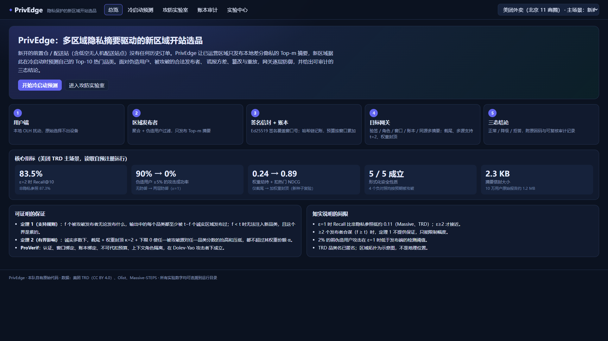

**创新点 1：两层抗投毒聚合**
- 第一层在**发布端**（能看到原始 LDP 报告）：诚实 OLH 报告同时支持一组固定品类的概率约为 g^−k，而伪造报告为了推高目标品类，会同时支持全部目标。用这一点找出联合支持异常的报告簇并剔除。
- 第二层在**新站网关**（只能看到签名摘要）：留一共识截尾（上下限 [0, 共识 + 3×尺度]）、多源支持规则（品类必须被 ≥2 个源发布）、权重封顶（每个源权重 ≤ 其余源中位数的 2 倍）。
- 两层分工：第一层管伪造用户，第二层管签名合法但已被攻破的发布者。

**效果**：ε=1、1 个源混入 5% 伪造用户时，无防御下攻击成功率（3 个冷门品类挤进 Top-10 的比例）为 0.26–0.59，防御后 ≤0.02；伪造比例 10% 时，无防御 0.90–1.00，防御后 ≤0.02（三套数据，E9）。在 TRD 上，单源"劫持 + 扣热门"使 NDCG 从 0.925/0.962 跌到 0.24/0.32（仅截尾），加权重封顶后恢复到 0.89/0.96（ε=1/2，E13）。无攻击时 NDCG 变化在 [−0.0012, +0.0198]（E9）。

**创新点 2：可证明的容错界**
- **定理 1（支持规则）**：输出的每个品类至少有 t−f 个诚实源发布过。所以少于 t 个被攻破源，无法注入任何诚实源都没发布过的品类。这个界是紧的：f=t=2 时构造的 300 次注入全部成功。
- **定理 2（有界影响）**：诚实多数（f < (n+1)/2）下，任一品类的融合分数满足 (1−α)S_i^H ≤ S_i ≤ (1−α)S_i^H + αU_i，攻击者的权重份额 α ≤ fκW / ((n−f)w + fκW)。

**创新点 3：形式化验证的签名发布协议与预算账本**
- ProVerif 2.05 验证 5 条性质：Q1 认证与窗口绑定、Q2 账本绑定、Q3 上下文角色隔离、Q4 原始数据保密、Q5 不可代扣预算。
- 4 个负对照：每次只去掉一项检查，都按预期被攻破。其中 nc4 对应我们在设计审查中发现并修复的真实缺陷（账本登记不验签）。

---

## 4 系统怎么工作：一次冷启动预测的完整过程

下面按控制台"冷启动预测"页的默认参数走一遍：TRD、1 个目标商圈、10 个源商圈、每源 5,000 名用户、ε=2、每个源发布 m=40 个品类、预测 k=10。预注册实验除 m=20 外流程相同，文中引用的实验数字来自 m=20 的运行。

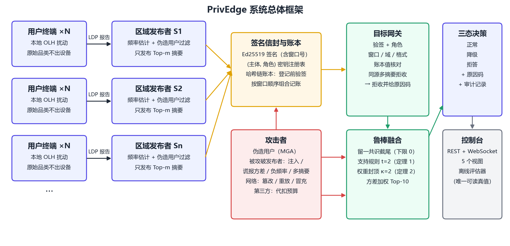

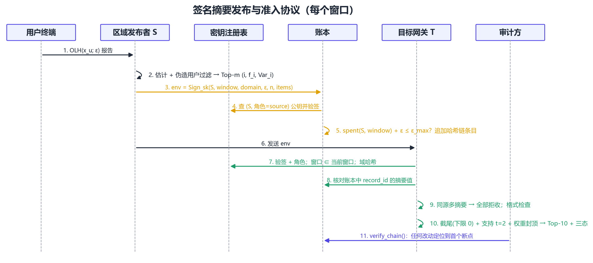

**第 1 步：用户端扰动（`ldp.perturb`）**
每个用户在自己设备上随机抽一个哈希种子，把自己的品类哈希到 g = round(e^ε)+1 个桶之一。以概率 p 报告真实桶，否则报告其他桶。离开设备的只有（种子, 桶）这一对数，不含品类本身。

**第 2 步：发布端估计与过滤（`pipeline.summarize_reports`、`robust.filter_fake_reports`）**
区域服务器先检查报告中是否有联合支持异常的品类组（z>6）。如果有，剔除同时支持这组品类的报告。然后估计每个品类的频率与方差，取 Top-m 组成摘要。无攻击时过滤器从不触发；β≥5% 时伪造报告移除率 98.1–100%，诚实报告误删 1.56–1.61%（ε=1）/ 0.18–0.21%（ε=2）（E9）。

**第 3 步：签名与登记（`envelope.seal`、`ledger.append`）**
摘要装入信封：窗口号、域哈希、哈希族、ε、用户数、m 个（品类, 频率, 方差）。用该区域的 Ed25519 数据源密钥签名。账本先验签，再检查本窗口累计 ε 是否超限，通过后追加到哈希链。

**第 4 步：网关准入（`gateway.admit`）**
新站网关逐份检查：密钥是否注册、角色是否匹配、签名是否有效、窗口是否当前、域是否一致、ε 与用户数是否合规、账本中是否有这份摘要且摘要值一致、同一源是否提交了多份不同摘要。不通过的写明原因码（共 17 个，如 `SIGNATURE_INVALID`、`STALE_WINDOW`、`EQUIVOCATION`、`UNKNOWN_KEY`）。

**第 5 步：鲁棒融合（`decision.robust_top_k`）**
- 截尾：每个源的每个频率被截到 [0, 其余源中位数 + 3×尺度]，尺度用其余源的方差计算；
- 权重封顶：按方差倒数算权重，每个源不超过其余源中位数的 2 倍；
- 调用团队原始的加权融合 `_weighted_fusion` 排序；
- 支持规则：只保留被 ≥2 个源发布的品类，取前 10。

**第 6 步：三态决策（`decision.decide`）**
- 可信源少于 3 个，或候选不足 10 个：**拒答**；
- 源间平均一致度 < 0.2，或上下文未通过验证：**降级**（仍输出，附原因）；
- 否则：**检查通过**（界面不再写成“预测正常”）。
- 源异常分数只作告警，不改变状态。
- 这三态只反映来源数量、支持规则和源间一致度，不保证 Recall。例如 TRD 在 ε=0.5、m=40 时可以全部是检查通过，平均 Recall 仍只有约 0.53（E10）。

**第 7 步：审计记录（`ColdStartService.predict`）**
记录输入摘要的哈希、账本头、链校验结果、准入摘要、决策与原因，并对整条记录取哈希。

**离线评估**：目标商圈的真实品类分布只在这一步读取，用来算 Recall@10 和 NDCG@10。测试 `test_inference_interfaces_cannot_receive_target_truth` 检查推理接口拿不到真值。

---

## 5 已经做出来的东西

### 5.1 代码模块（`D:\比赛\privedge\privedge\`，Python 3.12）

| 模块 | 行数 | 功能 |
|---|---|---|
| `research_core/`（9 个文件） | — | 团队原始研究代码的逐字节副本（融合算法、指标、OLH 参照实现），SHA-256 校验 |
| `algorithms.py` | 54 | 桥接：原样导出原始融合函数与指标 |
| `ldp.py` | 126 | OLH 用户端扰动 / 发布端估计，与原始实现逐位一致 |
| `robust.py` | 184 | 发布端伪造用户过滤、留一截尾、权重封顶、源异常分数 |
| `decision.py` | 145 | 鲁棒 Top-K、支持规则、三态决策与原因码 |
| `envelope.py` | 131 | 摘要 / 上下文信封、规范化序列化、Ed25519 签名 |
| `keys.py` | 70 | 密钥注册表，(主体, 角色) 绑定 |
| `ledger.py` | 137 | 哈希链账本、登记前验签、ε 合法性检查、预算累计与超限拒绝 |
| `gateway.py` | 166 | 网关准入与 17 个原因码 |
| `pipeline.py` | 140 | 发布者、上下文发布、冷启动服务（先校验账本再预测，含审计记录） |
| `attacks.py` | 78 | 攻击库 |
| `adapters/` | 296 | TRD、Olist、Massive 的导出与统一加载 |
| `experiments/` | 约 1,400 | 预注册实验运行器、比对工具、出图脚本 |
| `server/` | 540 | FastAPI 应用、演示引擎、证据读取 |
| `formal/privedge_release.pv` | 139 | ProVerif 模型 |
| `web/src/` | 约 1,230 | React 控制台 |
| `tests/` | 457 | 46 个测试，全部通过 |

### 5.2 攻击与防御对照（控制台"攻防实验室"可一键巡检）

| 攻击 | 类别 | 防御 | 证据 |
|---|---|---|---|
| 伪造用户（MGA） | 数据投毒 | 发布端联合支持过滤 | E9、`test_mga_attack_and_publisher_filter` |
| 被攻破发布者注入品类 | 被攻破 | 支持规则 t=2 + 留一截尾 | 定理 1、E9、`test_compromised_publisher_is_excluded` |
| 权重劫持（谎报极小方差） | 被攻破 | 权重封顶 κ=2 | 定理 2、E13、`test_weight_cap_limits_variance_underreporting` |
| 劫持 + 扣热门 | 被攻破 | 权重封顶 + 截尾下限 0 | E13 |
| 发布负频率 | 被攻破 | 截尾下限 0 | E15、`test_negative_frequencies_cannot_delete_items` |
| 篡改摘要 | 网络 | 签名校验 → `SIGNATURE_INVALID` | ProVerif Q1 |
| 重放旧窗口 | 网络 | 签名覆盖窗口号 → `STALE_WINDOW` | ProVerif Q1、nc1 |
| 同源多摘要 | 被攻破 | 全部拒收 → `EQUIVOCATION` | `test_equivocating_source_cannot_count_twice` |
| 冒充其他区域 | 网络 | 注册表 (主体, 角色) → `UNKNOWN_KEY` 等 | ProVerif Q1 |
| 代扣隐私预算 | 账本 | 账本登记前验签 | ProVerif Q5、nc4、`test_ledger_rejects_budget_burning_by_third_parties` |
| 用负数或 NaN 的 ε 绕过预算上限 | 被攻破 | 账本与网关先拒绝非正、非有限的 ε → `EPSILON_INVALID` | `test_invalid_epsilon_cannot_reset_or_poison_the_budget` |
| 篡改已登记的账本记录 | 账本 | 预测前先校验哈希链，断裂即拒答 → `LEDGER_CORRUPTED` | `test_prediction_refuses_when_ledger_is_corrupted` |
| 通过控制台读取任意文件 | 网络 | 静态路由只返回 `web/dist` 内的文件 | `test_static_route_never_leaves_web_dist` |

### 5.3 实验（全部先写预注册再运行）

预注册文档与结果都在 `privedge/experiments_prereg/`，运行目录在 `privedge/runs/`。

| 编号 | 实验 | 在说明什么 | 关键结果 |
|---|---|---|---|
| E1 | 复现核对 | PrivEdge 没有改变原始算法的结果 | Olist 120 行，最大差值 0 |
| E2–E5 | v1 攻防与上下文（历史） | 使用上下文的早期版本 | 只在附录引用 |
| E6 | 开销 | 部署成本 | 摘要 2,303 字节；每用户扰动约 1.2 µs（电脑批量测）；发布端 5 千用户约 22 ms，10 万用户 / 500 类约 1.4 s；网关一次预测约 8–9 ms |
| E7、E11 | 数据审计 | 数据可用性 | Olist Gate D 未通过（上下文无增益）；TRD 11 商圈、122 类、183,346 名首单用户 |
| E8 | Massive 复算 | 错配上下文的危害 | NDCG 下降 0.116 |
| **E9** | **SECURITY_V2 主线攻防** | 两层防御的效果与代价 | 见第 3 节；预注册判定 9/12、8/12、8/12（未满足的大多是攻击本身几乎无效的单元） |
| **E10** | **UTILITY_V1 隐私—效用** | 可用性 | TRD ε=2：Recall@10 0.835、NDCG 0.966（非隐私 0.873 / 0.973） |
| E12 | SECURITY_V3（探索） | 发现权重劫持这一新攻击 | 只截尾时 NDCG 下降 0.44–0.66；封顶的 H1 未满足，**按规则未采用** |
| **E13** | **SECURITY_V4（确认）** | 新种子复验权重封顶 | 单源劫持 / 扣热门下与无攻击的差距 ≤0.09；其余场景与 D3 完全相同；**采用** |
| E14 | 封顶对效用的影响 | 默认配置不损失效用 | 1,920 行与 E10 完全相同 |
| E15 | 负频率核对 | 截尾下限 0 不改变已有结果 | 67,200 个诚实值中负值 0 个 |
| **E16** | **ProVerif** | 协议安全 | 5 条性质成立，4 个负对照按预期被攻破 |
| **E17** | **容错定理** | 理论保证 | 定理 1、2 有证明，400 次随机试验的性质测试 |
| E18 | 演示系统 | 系统完整性 | 控制台调用真实管线，实验中心读取登记结果 |
| **E19** | **默认配置复核** | 最终配置下结论仍成立 | 14,880 行 0 行变化 |

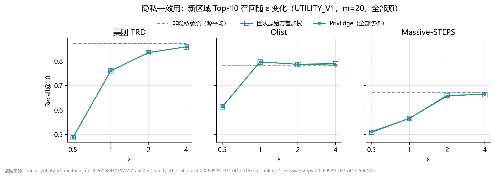

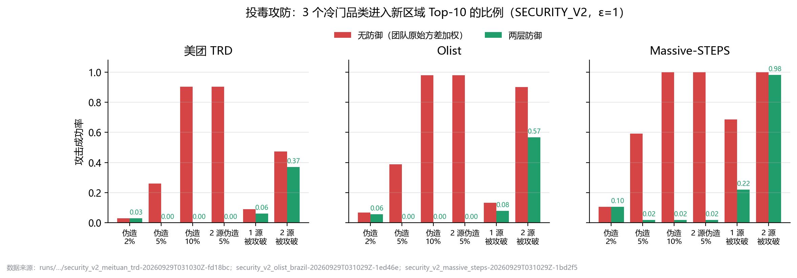

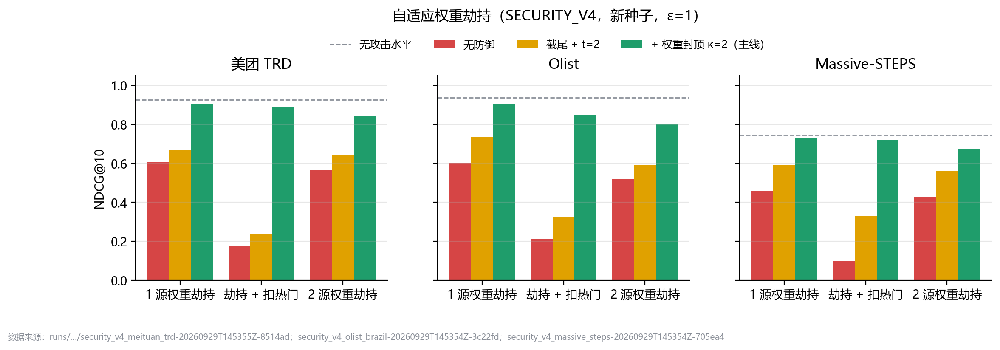

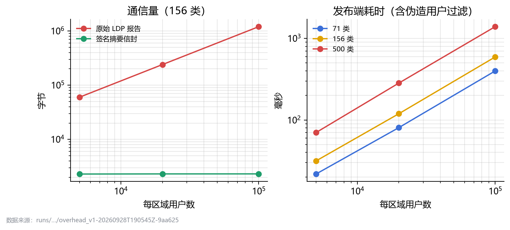

**实验演进**：v1（用上下文）→ v2（不用上下文，主线）→ V3（发现权重劫持，探索）→ V4（新种子确认权重封顶）→ v4.1（默认 D4 = 过滤 + 截尾（下限 0）+ t=2 + κ=2），并重跑核对。

### 5.4 理论与形式化

- `03_容错定理与证明.md`：定理 1、2，引理 A–D，假设与紧性构造；
- `formal/privedge_release.pv` + `experiments/formal_v1.py`：自动生成 4 个负对照并逐一验证，全部约 2 秒；
- 结果：`experiments_prereg/FORMAL_V1_RESULT.md`。

### 5.5 演示控制台

启动后浏览器打开 `http://127.0.0.1:8765`，右上角可切换数据集（TRD / Olist / Massive）。

| 页面 | 能看到什么 | 能操作什么 |
|---|---|---|
| 总览 | 场景、五步流程、核心指标、两条定理、局限 | — |
| 冷启动预测 | 源拓扑（示意图）、实时执行日志、三态结论、Top-10 与支持数、源分数 | 选目标区域、ε、m、攻击类型，运行并观看每一步 |
| 攻防实验室 | 10 种攻击的有无防御对比、拒收原因码 | 单个运行或一键巡检 |
| 账本审计 | 哈希链条目、各源预算使用、审计记录、密钥注册表 | 篡改演练：改一条历史记录，看链校验定位断点 |
| 实验中心 | 效用曲线、攻防柱状图、劫持实验、形式化表格、开销、预注册文档 | 切换 ε、数据集；每张图标注来源运行 ID |

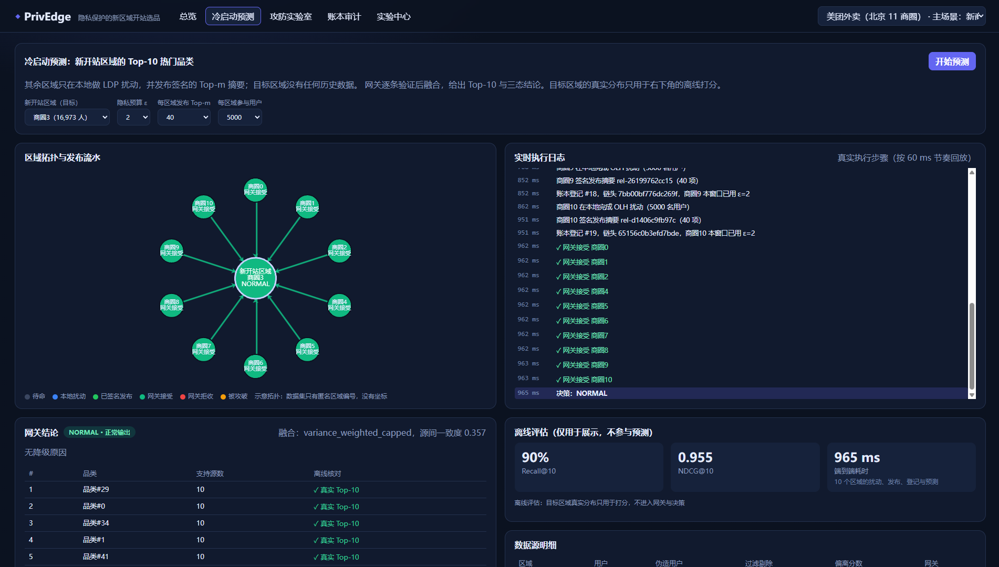

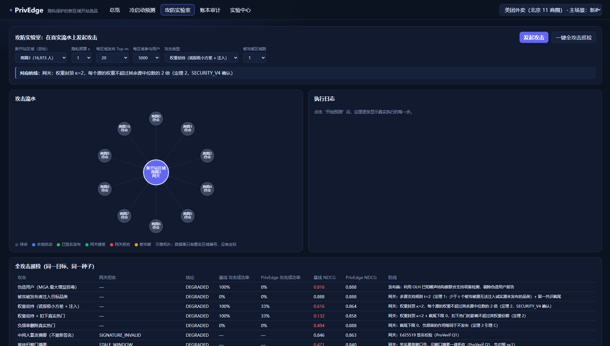

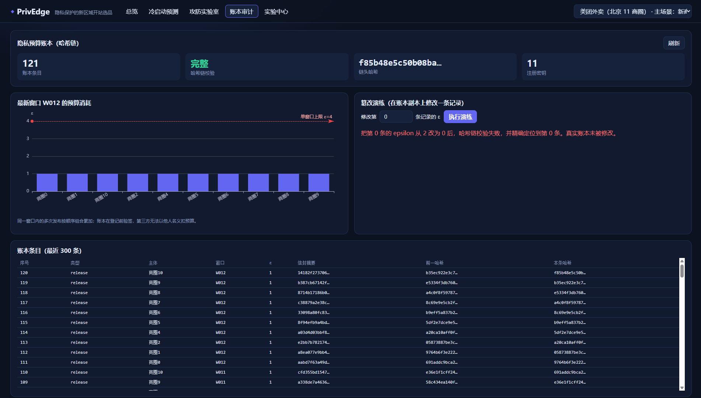

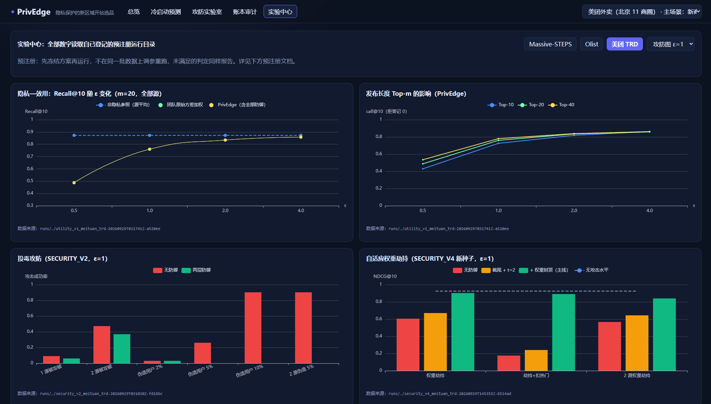

### 5.6 文档

| 文件 | 内容 | 状态 |
|---|---|---|
| `01_作品总体设计与对标方案.md` | 设计定稿 | 完成 |
| `02_实验证据登记.md` | 每个数字的来源 | 持续更新 |
| `03_容错定理与证明.md` | 定理与证明 | 待独立复核 |
| `04_作品报告初稿.md` | 完整初稿（摘要、概述、设计与实现、测试、创新性说明、总结、参考文献、附录），13 张图 | 待排版、核对文献、扩写相关工作 |
| `05_成员贡献与分工.md` | 贡献表模板 | 待分工后填写 |
| `06_团队进度与分工计划.md` | 旧版分工计划 | 已由本文取代 |
| `07_项目全景说明（团队共享版）.md` | 本文 | — |
| `08_相对团队原始研究代码的改动记录.md` | 沿用 / 重写 / 新增的对照与改动流水 | 每次改代码后追加 |
| `privedge/README.md`、`THIRD_PARTY_LICENSES.md` | 运行说明、数据与依赖许可 | 完成，待干净电脑验证 |

---

## 6 与团队原始研究代码的关系（摘要）

详细内容见 `08_相对团队原始研究代码的改动记录.md`，这里只列最重要的五点：

1. **原始融合算法一字未改**：9 个文件逐字节复制到 `research_core/`，测试校验哈希。实验中的"D0（无防御）"就是原始 `fuse_variance_weighted`。
2. **OLH 重写但结果逐位一致**：为了拿到"每个用户的报告"，把扰动和估计拆开，随机数消耗顺序不变。
3. **哈希不同**：原始代码装了 xxhash 就用 xxhash，原始 `outputs/` 的历史数字就是这样跑的；PrivEdge 固定用 splitmix64 备用哈希。所以 PrivEdge 的数字不能和原始历史数字逐位比较。
4. **方向变化**：从"哪种融合更准"转向"在隐私下是否可信"。主线从"截断感知 + 上下文"改为"方差加权 + 鲁棒层"，上下文降为附录。
5. **数据更换**：Books / Yelp → TRD（主）/ Olist / Massive。

---

## 7 缺陷与局限

每一条都要如实写进报告，答辩时主动讲。"能否改进"一列标注了可以变成任务的条目。

### 7.1 方法效果

| 编号 | 局限 | 具体数字 | 原因 | 能否改进 |
|---|---|---|---|---|
| L1 | ε=1 时可用性明显下降 | Recall@10 比非隐私低约 0.11（Massive −0.106、TRD −0.113） | LDP 噪声本身的代价 | 只能如实写；"接近非隐私"只在 ε≥2 时成立 |
| L2 | ≥2 个被攻破源合谋时注入挡不住 | ε=1 残余成功率 0.98 / 0.57 / 0.37（Massive / Olist / TRD）；2 源劫持注入 0.93–1.00 | 定理 1 只保证 f<t | t=3 可压到 0.29 / 0.41 / 0.34，代价是 Massive ε=1 无攻击 NDCG −0.039，写成权衡 |
| L3 | 2% 的弱伪造攻击在 ε=1 时检测不到 | 移除率 0 | 低于统计检测阈值 | 该攻击成功率本身只有 0.03–0.11，如实写 |
| L4 | 权重封顶主要恢复排序，对注入抑制不稳定 | V3 的 H1 未满足 | 注入由支持规则负责 | 如实写 |
| L5 | 源异常分数在异质城市误报多 | Massive 无攻击时 6 个诚实源中 1.9–3.8 个被标记 | 城市间真实差异大 | **可做**：预注册校准实验（任务 A5） |
| L6 | 降级阈值 0.2 未校准 | ε≤1 时大量"降级" | 阈值是经验值 | 可与 L5 一起校准 |
| L7 | 源少或 m 小时拒答多 | 3 个源、ε=1 拒答：Massive 23%、TRD 11%；m=10、ε≤1 Massive 拒答 20–60% | 候选不足 | 部署默认 m=40，如实写 |
| L8 | t=1 与 t=2 实验输出相同 | 全部行相同 | 截尾已挡住单源注入 | t=2 的价值是可证明保证，不是实验增益，报告里要这样表述 |

### 7.2 数据与证据

| 编号 | 局限 | 处理 |
|---|---|---|
| D1 | TRD 品类名和商圈名已匿名，只有北京一个城市、28 天 | 报告称"真实外卖订单代理任务"；拓扑图标注"示意图" |
| D2 | TRD 在 Zenodo 上没写明美团授权 | 报告注明来源与 CC BY 4.0 许可；可选：邮件问上传者 |
| D3 | Olist 为 CC BY-NC-SA 4.0，仅限非商业 | 许可清单已注明 |
| D4 | 用户端耗时是电脑批量测的，不是手机实测 | 如实写；可选补测（任务 C7） |
| D5 | ProVerif 模型不含预算数值累加、数值合法性、同源多摘要、统计防御 | 由代码测试和定理覆盖，已写明。10-09 队内审查发现的"负数 / NaN 的 ε 绕过预算"正属于模型覆盖不到的数值问题，已修复并补测试 |
| D6 | 哈希族是 splitmix64 备用实现，不是 xxhash | 报告已注明；统计性质等价 |
| D7 | UTILITY_V1 首次运行的"状态"列早于一处修正 | 指标与正式运行逐行相同；状态列不引用 |

### 7.3 工程与材料

| 编号 | 缺陷 | 影响 |
|---|---|---|
| G1 | 10-11 仓库已改为公开：<https://github.com/18672919390/privedge> | 任何人可克隆；提交材料仍要按官方要求匿名，数据许可仍限制商业使用 |
| G2 | 演示后端的账本在内存中，重启清空 | 演示前要说明，或做持久化 |
| G3 | 接口没有登录鉴权 | 只作演示用，报告写明"演示环境" |
| G4 | 前端打包 1.2 MB（ECharts 未拆分） | 首次加载稍慢 |
| G5 | 报告未排进官方模板；23 条参考文献未逐条核对；相关工作偏薄 | 直接影响评分 |
| G6 | 没有演示视频 | 视通知决定是否必需 |
| G7 | 10-01 已用共享包在本机全新目录中验证：从零安装依赖、27 个测试通过、控制台可运行；**还没在另一台电脑上验证** | 评审复现可能卡住 |
| G8 | 控制台截图：总览页已于 10-01 重截；其余 4 页是 09-29 版本 | 界面如有改动，定稿前重新截图 |
| G9 | 10-09 队内代码审查发现 3 个问题：负数 / NaN 的 ε 能绕过预算上限；账本被改后仍正常预测；控制台静态路由可读取电脑上任意文件。**已全部修复**，补 18 个回归测试（共 45 个），重跑 TRD 主线实验与登记结果 4,510 行 0 变化（E20） | 说明还需要继续做对抗性自查，例如对全部接口参数做异常值测试 |

---

## 8 剩余工作：待认领任务

完整任务清单单独放在 `09_任务清单（待认领）.md`（同目录还有可用 Excel 打开的 `任务认领表.csv`）。每项任务写明做什么、交付什么、怎样算完成、需要的能力、工作量、建议截止和依赖，认领人留空，由大家按个人情况认领。

| 类别 | 内容 | 必做 | 可选 |
|---|---|---|---|
| A 算法与实验 | 复现实验、核对第三章数字、扩写相关工作、核对参考文献、算法答辩讲稿、简单平均与外部防御对照；可选：异常分数与降级阈值校准 | 7 人日 | 4 人日 |
| B 安全与形式化 | 复现 ProVerif、定理复核、模型与代码对照表、隐私论证、安全章节润色、安全问答库、接口与输入的对抗性自查；可选：威胁模型图 | 8 人日 | 1 人日 |
| C 系统、演示与复现 | 走一遍控制台、自己电脑从零复现、提交用复现包、演示视频、更新截图；可选：控制台打磨、手机端实测 | 6 人日 | 2.5 人日 |
| D 报告与材料 | 报名与审核（队长）、确认官方要求、模板排版、摘要与创新性说明、合稿、匿名检查、贡献表；入围后：答辩 PPT | 6.5 人日 | 0.5 人日 |

## 9 时间计划

| 阶段 | 日期 | 目标 | 里程碑 |
|---|---|---|---|
| 启动 | 9-30 ~ 10-04 | 全员读文档、跑通环境、做上手任务；确认官方要求；建 Git；**开始报名** | 10-04 启动会后完成认领 |
| 主体 | 10-05 ~ 10-12 | 各类主体任务：文献、定理复核、安全论证、自己电脑复现、视频脚本 | **10-08 提交学校审核**；10-12 各章节修订稿交给统筹 |
| 整合 | 10-13 ~ 10-17 | 合并报告、录视频、做复现包、第一轮模拟答辩 | 10-15 模拟答辩；10-16 视频成片；10-17 报告初版 PDF |
| 定稿 | 10-18 ~ 10-21 | 确认审核通过；按反馈修改；匿名与格式检查；第二轮模拟答辩 | **10-18 审核通过**；10-19 模拟答辩；10-21 终审 |
| 提交 | 10-22 | 提交 | — |

建议每周一、周四各开一次 15 分钟站会，对照 `09_任务清单` 更新进度。

---

## 10 上手指南

### 10.1 环境

- 本机：Windows 11、Python 3.12.14（虚拟环境 `privedge\.venv`）、Node 24；
- 新电脑：按 `privedge/README.md` 用 `requirements.lock` 安装 Python 依赖，在 `web/` 下运行 `npm install`；
- ProVerif 2.05 在 `D:\比赛\tools\proverif\`（只有跑形式化验证才需要）。

### 10.2 五条常用命令（PowerShell，在 `D:\比赛\privedge` 下）

```powershell
$env:PYTHONPATH='D:\比赛\privedge'

# 1. 跑全部测试（约 10 秒，应显示 46 passed）
.\.venv\Scripts\python.exe -m pytest -q

# 2. 启动控制台（然后浏览器打开 http://127.0.0.1:8765）
.\.venv\Scripts\python.exe -m uvicorn privedge.server.app:app --port 8765

# 3. 复现一个攻防实验（结果写进新的运行目录，不覆盖旧结果）
.\.venv\Scripts\python.exe -m privedge.experiments.security_v1 --protocol v2 --dataset meituan_trd --v41-policy

# 4. 与登记结果逐行比对（运行 ID 即 runs\ 下的目录名；TRD 的已登记 ID 是 security_v2_meituan_trd-20260929T031030Z-fd18bc）
.\.venv\Scripts\python.exe -m privedge.experiments.compare_runs 'security_v2_meituan_trd-20260929T031030Z-fd18bc=<第 3 步生成的运行ID>'

# 5. 形式化验证
.\.venv\Scripts\python.exe -m privedge.experiments.formal_v1
```

命令参数以 `privedge/README.md` 为准。逗号分隔的参数在 PowerShell 里要加引号。

### 10.3 阅读顺序

1. 所有人：本文 → `04_作品报告初稿.md` 的摘要和第二章 → 在控制台里走一遍；
2. A 类任务：`08` → `ldp.py` → `robust.py` → `decision.py` → `experiments_prereg/`；
3. B 类任务：`03` → `envelope.py` → `keys.py` → `ledger.py` → `gateway.py` → `formal/privedge_release.pv`；
4. C 类任务：`README.md` → `server/engine.py` → `server/app.py` → `web/src/pages/`；
5. D 类任务：`04` 全文 → `02` → `01` 第 10–12 节。

---

## 11 协作规则

0. **版本汇总**：代码和文档统一汇总到公开仓库 <https://github.com/18672919390/privedge>。每人在自己的分支上改（例如 `git switch -c a3-related-work`），推到 GitHub 后发合并请求（Pull Request），由另一人看过再合并到 `main`。不要直接往 `main` 推，不要用 `git push --force`。没有推送权限时，把改好的文件发给队长合并。
1. **证据纪律**：报告中每个数字都必须能在 `02_实验证据登记.md` 找到编号。新实验先写预注册再运行；结果不好也照写；不在同一批数据上调参重跑。
2. **真值隔离**：目标区域的真实分布只用于离线打分，不能用于调参、选源或映射。
3. **不改旧结果**：不修改或覆盖 `runs/` 下已有目录、`D:\比赛\review\top-k-share-20260925\`、v3 旧文档和原始数据。新运行一律进新的运行 ID 目录。
4. **改代码要登记**：改了 `privedge/` 下的代码，要跑一遍测试，并在 `08` 第 7 节追加一行（改了什么、影响什么、依据是什么）。
5. **原创**：不复制往届作品的内容、图表、措辞。代码统一称"本队自有原始代码"。
6. **安全**：不上传原始数据、API 令牌、Kaggle 凭据；不提交任何凭据文件。
7. **表述**：不承诺获奖；不把 OpenAlex 当主应用数据；局限如实写。
8. **沟通**：发现与本文或报告冲突的地方，先写问题单交给统筹，不直接改结论。

---

## 12 常见问题

**Q1：为什么用本地差分隐私，不用联邦学习或同态加密？**
我们只需要区域级的品类频率，不需要训练模型。LDP 让原始数据在用户设备上就被扰动，服务器（包括区域运营方自己）也看不到真实值，通信只有一份约 2.3 KB 的摘要。同态加密和安全多方计算能保护计算过程，但区域运营方仍然看得到明文聚合结果；TEE 依赖硬件信任。这些可以写进相关工作的对比。

**Q2：为什么主数据集是美团 TRD？**
它是真实外卖订单，有商圈划分，最贴近"新站选品"。Olist（巴西电商）作跨国对照，Massive（城市签到）异质性最高，作压力测试。TRD 的局限见 D1、D2。

**Q3：为什么不说"预测更准"？**
团队原始研究已经发现，各种融合方法相对直接平均没有稳定优势。我们的贡献是加了安全层之后效用几乎不变（E9：无攻击 NDCG 变化在 [−0.0012, +0.0198]），同时挡住攻击。

**Q4：为什么公开上下文降为附录？**
Olist 和 Massive 的数据审计中，公开上下文都没有带来目标特异的增益（Gate D 未通过）；上下文错配时反而使 NDCG 下降 0.116（E8）。我们如实降级，只保留"上下文要签名验证、不因缺失而降级"的机制说明。

**Q5：预注册是什么？为什么有些判定"未满足"还写进去？**
预注册是在运行实验前，把假设、参数、判定规则写成文档冻结，运行后不再改。这样结果不是"挑出来的"。V3 的判定未满足，我们就没有采用权重封顶；换新种子做 V4 确认满足后才采用。未满足的判定照实写，是证据可信的一部分。

**Q6：定理 1 的 t=2 实验里和 t=1 一样，为什么还要它？**
因为截尾已经在统计上挡住了单源注入，但那是经验结果。t=2 给出不依赖任何统计假设的保证：只要被攻破的源少于 2 个，就不可能注入诚实源都没发布过的品类。

**Q7：ProVerif 证明了什么，没证明什么？**
证明了在 Dolev-Yao 网络攻击者模型下，签名、窗口绑定、角色隔离、账本绑定、登记验签这些检查足以保证 Q1–Q5。没证明差分隐私（Q4 只是符号意义下的保密），也不含预算数值累加和统计防御，这些由代码测试和定理 1、2 覆盖。

**Q8：控制台里的数字能直接写进报告吗？**
不能。控制台单次运行的数字只是示例。报告只引用预注册运行的结果（实验中心页面里每张图都标了来源运行 ID）。

---

## 13 文件地图

```text
D:\比赛\
├─ privedge\                         作品代码
│  ├─ privedge\                      Python 包（第 5.1 节）
│  │  ├─ research_core\              团队原始算法的逐字节副本（勿改）
│  │  ├─ adapters\  experiments\  server\
│  ├─ web\                           React 控制台
│  ├─ tests\                         46 个测试
│  ├─ formal\                        ProVerif 模型
│  ├─ experiments_prereg\            预注册文档与结果
│  ├─ runs\                          全部运行目录（勿改旧目录）
│  ├─ data\                          导出后的三套数据（勿上传）
│  ├─ README.md  THIRD_PARTY_LICENSES.md  requirements.lock
├─ competition_entry\docs\v4\        设计、证据、定理、报告、本文
│  └─ figures\                       报告图表与控制台截图
├─ review\top-k-share-20260925\      团队原始研究代码快照（只读）
├─ dataset_research\                 数据审计记录
└─ tools\proverif\                   ProVerif 2.05
```
