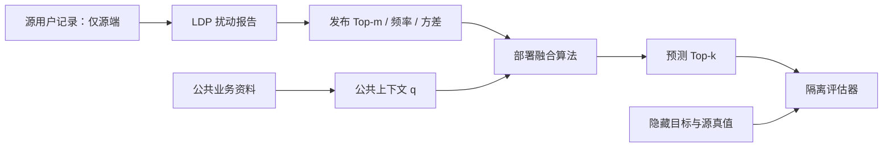

# v1 信息边界与当前代码核对

日期：2026-09-14。本次核对以可执行代码为准，不将旧文档或注释当作实现证明。
正式工作定义见 [RESEARCH_DEFINITION_V1.md](RESEARCH_DEFINITION_V1.md)。

## 信息流



模拟器先生成真值再模拟报告是允许的。禁止的是从真值到部署算法的额外信息通路。
实验种子用于复现模拟，不应成为部署算法重建真值的输入。

## 代码映射与检查结论

| 对象 | 代码入口 | 当前状态 / 下一步 |
|---|---|---|
| 目标/源/潜在画像 | `simulation.py::make_problem` | 属于模拟器；源直接混合目标是实验假设 |
| 用户与机制 | `experiment.py::_release`、`ldp_protocols.py` | 每个合成用户一个类别；共享函数模拟扰动和聚合 |
| 频率/方差来源 | `_plugin_variance`、`_release` | 方差基于扰动估计和公开参数；不是从真值求方差后发布 |
| 发布对象 | `fusion.py::ServerRelease` | 仅含 id、机制、项目、频率、方差；n/epsilon/版本/完整规则未封装 |
| 公开上下文 | `simulation.py` | 合成 q 在给定潜在画像时与目标独立采样；现实来源待落实 |
| 部署融合 | `fusion.py` 中非 oracle 方法 | 函数参数为发布、上下文和参数，未直接接收隐藏目标 |
| 统一实验预测 | `experiment.py::_predictions` | 同时接收 SyntheticProblem 并生成 oracle；执行上区分方法，结构隔离尚不充分 |
| oracle 诊断 | `oracle_weighted`、`global_true_average` | 有意使用隐藏信息；不得作为可部署方法或通用数学上界 |
| 评估真值 | `metrics.py::evaluate/migration_error` | 应仅用于报告指标；迁移诊断不应反馈当前测试配置选择 |
| 无上下文 | `_predictions` 的 None 分支 | 上下文方法回退 average；这是设计选择，不是不可识别性证明本身 |
| 可见性开关 | `problem_definition.py::VisibilityContract` | 禁止原始/目标真值字段为真，但频率/方差 False 没有落实屏蔽，不能证明缺信息场景支持 |
| top-2k 命名 | VisibilityContract.published_top2k | 实际支持可变 Top-m，接口名已过窄 |
| 自适应覆盖 | `experiment.py::run`、`fusion.py` | 记录全源并集，可能比选源后的实际候选更大；后续应另报实际集合 |
| 元数据与成本 | `estimated_payload_bytes` | 24 字节/项只算三元组，不含机制元数据、序列化与传输开销 |

后续接口修正建议：单独的部署入口只接收公开观察对象，另设诊断入口接收真值；
把发布元数据和处理规则显式封装；不支持的可见性组合直接拒绝，而不是静默忽略。
本步骤暂不重构融合算法或更改实验历史，避免文档定义与新的算法变更混在一起。

## 需要立即避免的误述

1. 后续真实数据实验需明确用户贡献单位；多事件贡献不能直接沿用单事件 epsilon。
   用户参与和群体成员身份也不由单事件的值替换保证自动覆盖。
2. 真实数据的经验目标分布不等于已知总体真值；应隔离评估与发布的随机流。
3. 现有合成“质量”参数不等于目标与上下文的真实相似度；不能将其输入权重当作已知
   可信度。当前融合函数未直接使用该参数，是符合边界的。
4. 隐私后处理性质只在完整发布链满足条件时成立；不替代机制正确性、参与隐私或
   多用户事件预算审计。攻击摘要也是单独的稳健性设定。
5. censor-aware 对 PEM 的最终阈值解释只是近似，不是全域未发布事件的精确模型。

## 可执行边界检查

`tests/test_information_boundary.py` 对当前 `_predictions` 做一个有限回归检查：

- 固定发布、公开 q 和算法参数，替换隐藏目标、源分布、相似度及问题对象内的 q；
  所有非 oracle 预测必须不变，至少一个 oracle 诊断应变化。
- 把允许输入的 q 置为 None 时，核查无上下文分支不从隐藏对象恢复上下文。
- 固定频率 oracle 的输出、改变原始采样总体，检查发布对象不再从原始用户引入信息；
  plug-in 方差内部公式另经代码核对，测试不构成对所有协议的形式化证明。

检查通过意味着这些实例未发现越界，不是形式化的信息流证明，也不能证明超参数
从未在测试标签上调优。更强的保证需要部署入口结构隔离和数据来源记录。

本次执行：2026-09-14，两个新增边界测试均通过。命令（top-k 目录）：

```powershell
./.runtime/python/python.exe -m unittest discover -s tests -p test_information_boundary.py -v
```

## 第一阶段验收

- 已记录：估计对象、可见/禁止信息、公开元数据假设、隐私单位和条件性后处理命题。
- 已记录：无约束目标的不可识别性及排序恢复充分条件；未冒充新定理贡献。
- 已定位：可见性开关未落实、元数据不足、评估和推断共用入口、自适应候选统计偏宽。
- 用户已确认：暂时只定义通用问题，没有具体公共上下文来源；现实数据来源和
  开发/测试隔离流程留待后续，不阻塞本版通用定义。
- 待后续实现：按定义封装入口、为后续真实数据明确贡献单位、针对选择机制建立理论模型。
